# RSA

## Task 1
We are given p, q and e. n = p * q and (e, n) as the public key. We are to find the public key d

``` 
p = F7E75FDC469067FFDC4E847C51F452DF
q = E85CED54AF57E53E092113E62F436F4F
e = 0D88C3
```

To calculate d:
```
phi(n) = (p - 1)(q - 1)
modular inverse such that (e x d)(mod phi(n)) = 1
```

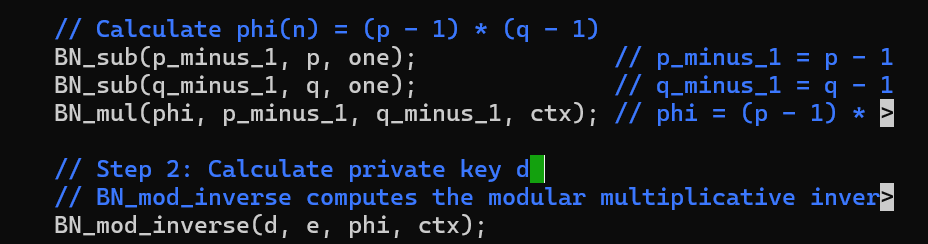

Derived private key
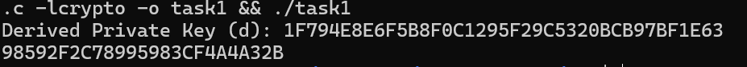

## Task 2: Encypting a Message
We are given a messsage in string format `A top secret!`
We convert it to hexadecimal first using the bignum library so that we can perform RSA encryption.
Encryption is denoted as 

```
C= M^e mod n
```
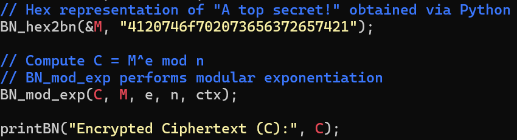

encrypted cyphertext
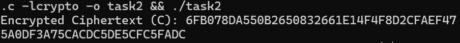

## Task 3: Decrypting a Message
The new cypher text provided is 
`C = 8C0F971DF2F3672B28811407E2DABBE1DA0FEBBBDFC7DCB67396567EA1E2493F`

The public and private keys are:

```
n = DCBFFE3E51F62E09CE7032E2677A78946A849DC4CDDE3A4D0CB81629242FB1A5
e = 010001 
M = A top secret!
d = 74D806F9F3A62BAE331FFE3F0A68AFE35B3D2E4794148AACBC26AA381CD7D30D

```

Code for decryption

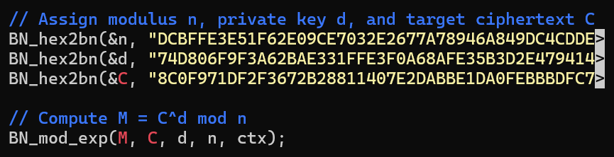

Conversion of hex back to string using python
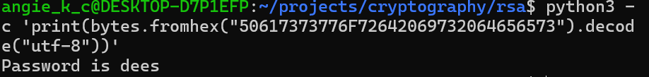

## Task 4: Signing a Message

Public and private keys used
```
n = DCBFFE3E51F62E09CE7032E2677A78946A849DC4CDDE3A4D0CB81629242FB1A5
e = 010001 
M = I owe you $2000.
d = 74D806F9F3A62BAE331FFE3F0A68AFE35B3D2E4794148AACBC26AA381CD7D30D

```

Signing helps in verifying:
1. The message was sent by the sender
2. The message has not been modified since signing
3. The signature corresponds to the sender's public key

Signing is done with the private key and verification uses the public key

The two alternate messages:

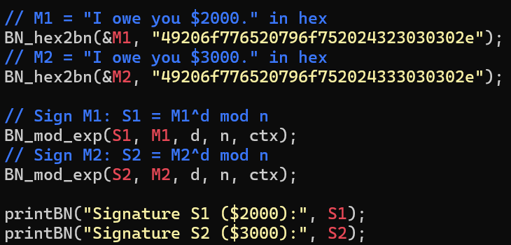

Changing a single character produces a completely different signature 
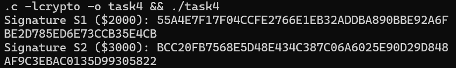

## Task 5: Verifying a Signature

```
M = Launch a missile.
S = 643D6F34902D9C7EC90CB0B2BCA36C47FA37165C0005CAB026C0542CBDB6802F
e = 010001 (this hex value equals to decimal 65537)
n = AE1CD4DC432798D933779FBD46C6E1247F0CF1233595113AA51B450F18116115

```
Code for verifying signatures

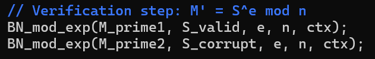

Decrypted hex signatures

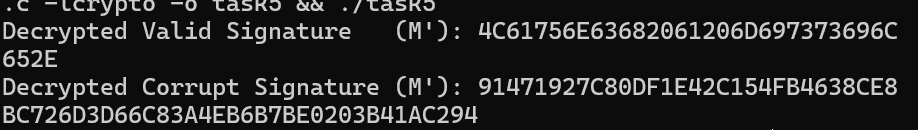

Hex Converted to String

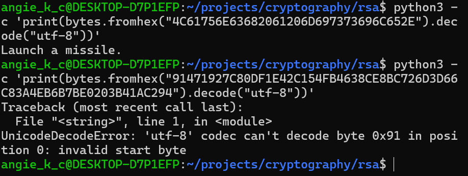

The corrupted signature threw a `UnicodeDecodeError` because the decryption result is not valid.
The original message cannot be recovered.

## Task 6: Manually Verifying an X.509 Certificate
An X.509 contains data about a public key and an issuer’s signature on the data. 

### Step 1: Download a cetificate from a real web server

Paypal returned 2 certificates

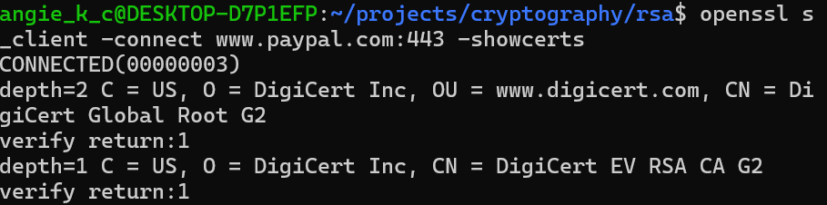

Saved the first block as c0.pem and the second as c1.pem(Issuer Certificate)

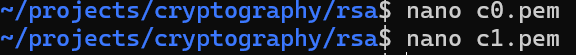

### Step 2: Extract the public key (e, n) from the issuer’s certificate. 

Extracted the public key (e, n) from c1(the issuer)

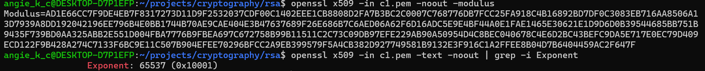

### Step 3: Extract the signature from the server’s certificate.

Extracting the signature then removing the spaces and colons from the data so that we get a hex that can be used in the program

Snippet of the output

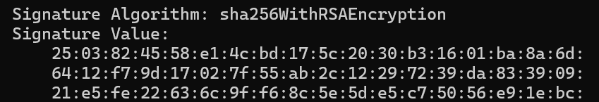

Cleaned data

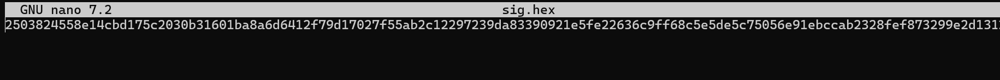

### Step 4: Extract the body of the server's certificate
Certificate Authority(CA) generates the signature for a server by first computing the hash, then signs the hash.

X.509 certificates are encoded using the ASN.1(Abstract Syntax Notation.One) standard.

We are partsing the ASN.1 structure to extract the body without its signature block.

SHA256 of the body

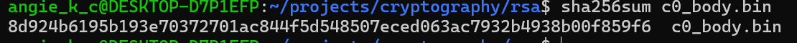

### Step 5: Verify the Signature


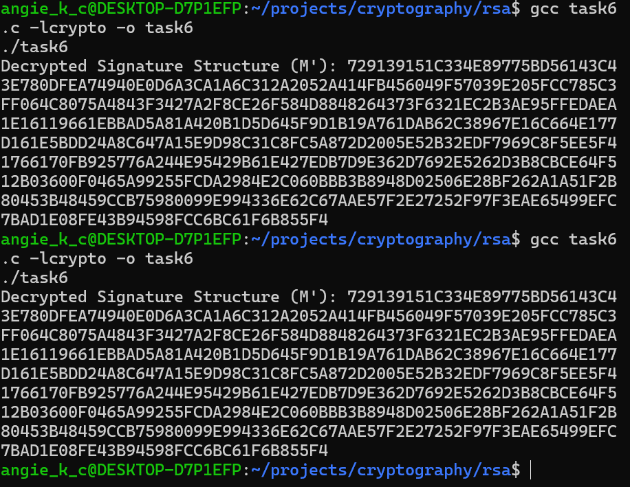