# Seed Lab Report: RSA Public-Key Encryption and Signature Lab

**Date:** 11th November, 2026

**Environment:** SEED Ubuntu VM

## 1. Overview
RSA (Rivest-Shamor-Adleman)
The RSA cryptosystem is a public-key algorithm based on modular exponentiation over large prime factors.

RSA uses a key pair: a public key for encryption/verification and a private key for decryption/signing. 

Because RSA key sizes range from 512 to 4096+ bits, operations exceed 64-bit primitive types and require arbitrary-precision Big Number libraries like OpenSSL `BIGNUM`.

## 2. Environment
GCC, OpenSSL (BIGNUM Library), Python 3

## 3. Task Implementation and Observations
This section contains secrenshots and a detailed explanation of the actions taken.

### Task 1: Deriving the Private Key
Given the prime numbers p, q and public exponent e that is relatively prime to  $\phi(n)$ (euler's totient of n)

```
p = F7E75FDC469067FFDC4E847C51F452DF   
q = E85CED54AF57E53E092113E62F436F4F 
n = p x q  
e = 0188C3
```

d, the private key is the modular inverse of e modulo $\phi(n)$.

It can also be represented as 

```
e * d ≡ 1 (mod φ(n))
```

The `BIGNUM` representation of this is

```
BN_mod_inverse(d, e, phi, ctx);
```

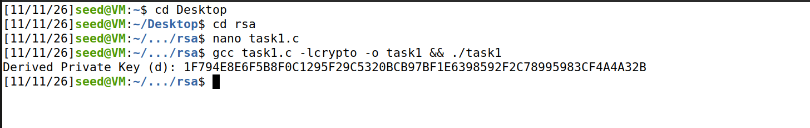
Private key d that has been generated

### Task 2: Encrypting a Message

Let (e, n) be the public key. The message to be encrypted is `A top secret!`.
The ASCII string is first converted to Hex using python.

```
$ python3-c ’print("A top secret!".encode("utf-8").hex())’
4120746f702073656372657421
```
message converted to Hex

```
n = DCBFFE3E51F62E09CE7032E2677A78946A849DC4CDDE3A4D0CB81629242FB1A5
e = 010001 (this hex value equals to decimal 65537)
M = A top secret!
M(Hex) = 4120746f702073656372657421
d = 74D806F9F3A62BAE331FFE3F0A68AFE35B3D2E4794148AACBC26AA381CD7D30D
```
The public keys together with d for verification

```
C = M^e mod n
```
Formula for encryption

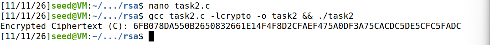
encrypted message

### Task 3: Decrypting a Message
The goal is to decrypt the cipher text and to convert the resulting Hex back into ASCII String.

```
C = 8C0F971DF2F3672B28811407E2DABBE1DA0FEBBBDFC7DCB67396567EA1E2493F
```
The ciphertext

```
// Compute M = C^d mod n
    BN_mod_exp(M, C, d, n, ctx);
```
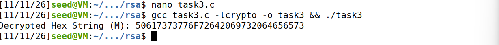
Decrypted Hex String

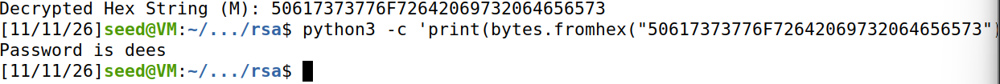
Hex converted to ASCII String

### Task 4: Signing a Message
Digital signatures are used to prove authenticity.
They provide:
1. Authenticity: verifying who signed the message
2. Integrity: detects whether the message has been changed
3. Non-repudiation: provides evidence that the holder of the private key signed the message

```
S = H(M)^d mod n
```
H(M) is the hashed message

```
n = DCBFFE3E51F62E09CE7032E2677A78946A849DC4CDDE3A4D0CB81629242FB1A5
e = 010001 (this hex value equals to decimal 65537)
M = A top secret!
M1 = I owe you $2000.
M2 = I owe you $3000.
d = 74D806F9F3A62BAE331FFE3F0A68AFE35B3D2E4794148AACBC26AA381CD7D30D
```
The message and the public/private keys

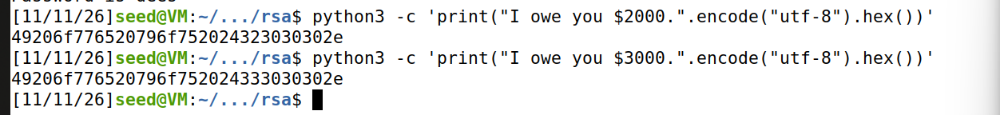
Hex version of the messages before signing

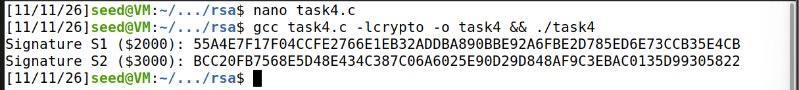
Message 1 and 2 are signed very differently despite changing 1 value. It is unidentifiable.

### Task 5: Verifying a Signature

Bob received the message `Launch a missile.` with a signature S. The goal is to verify if it is from Alice

```
M = Launch a missile.
S = 643D6F34902D9C7EC90CB0B2BCA36C47FA37165C0005CAB026C0542CBDB6802F
e = 010001 (this hex value equals to decimal 65537)
n = AE1CD4DC432798D933779FBD46C6E1247F0CF1233595113AA51B450F18116115
```
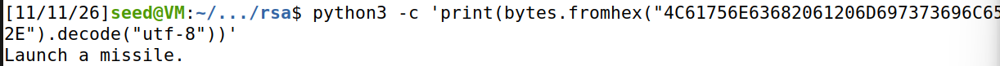
The signature decodes to the intital message

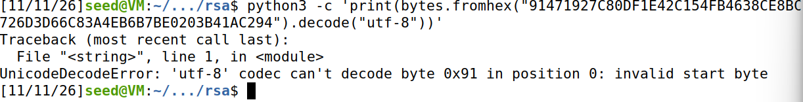
Corrupting the last bit results in a UnicodeDecodeError because of invalid bits.

### Task 6: Manually Verifying an X.509 Certificate 

#### Step 1: Download a certificate from a real web server
We downloaded a certificate, Paypal's.

```
openssl s_client -connect www.paypal.com:443 -showcerts
```
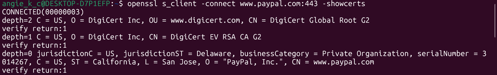

#### Step 2: Extract the public key (e, n) from the issuer’s certificate
Extracting (e, n) from the issuer's certificate

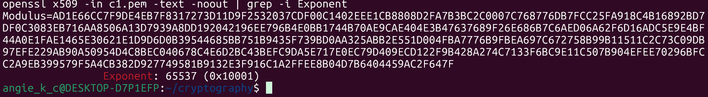

```
AD1E66CC7F9DE4EB7F8317273D11D9F2532037CDF00C1402EEE1CB8808D2FA7B3BC2C0007C768776DB7FCC25FA918C4B16892BD7DF0C3083EB716AA8506A13D7939A8DD192042196EE796B4E0BB1744B70AE9CAE404E3B47637689F26E686B7C6AED06A62F6D16ADC5E9E4BF44A0E1FAE1465E30621E1D9D6D0B39544685BB751B9435F739BD0AA325ABB2E551D004FBA7776B9FBEA697C672758B99B11511C2C73C09DB97EFE229AB90A50954D4C8BEC040678C4E6D2BC43BEFC9DA5E717E0EC79D409ECD122F9B428A274C7133F6BC9E11C507B904EFEE70296BFCC2A9EB399579F5A4CB382D927749581B9132E3F916C1A2FFEE8B04D7B6404459AC2F647F
```
Value of n

```
 65537
```
Value of e

#### Step 3: Extracting the signature from the server's certificate
When the SHA256 hashed signature is extracted, it has colons and spaces which need to be cleaned.

```
openssl x509 -in c0.pem -text -noout
```

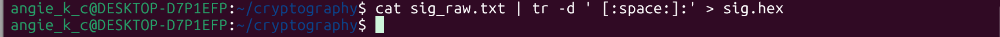
```
2503824558e14cbd175c2030b31601ba8a6d6412f79d17027f55ab2c12297239da83390921e5fe22636c9ff68c5e5de5c75056e91ebccab2328fef873299e2d13138d8c618fc3bd472750ac290aa507a86486f64b1f27184ec1dd10ec6bd19c66094424d42b750f5402b09474b091621acd77075b35ecffae942e721aa4cbb48592ab5a08bc644dfcf273f8613f5f15fef19c7cab747c4276625021055c9fdc0fb79c4f5460b62b2a59f21ffbec134bdd501d541552c2684b369dffadf3cc3372ac4dca0d411e446dd9cf00f4d9b461fc8634b667491803bb218d861b474d6bf95b8adcb2d8d8cd5a8dfb3621fcb1654a8613db0d1f2e6cc1898a071b945ca87
```
Cleaned signature

#### Step 4: Extract the body of the server's certificate
We are extracting the body so that we can compare it with the results gotten after verification of the signature

```
openssl asn1parse -i -in c0.pem
openssl asn1parse -i -in c0.pem -strparse 4 -out c0_body.bin -noout
sha256sum c0_body.bin
```
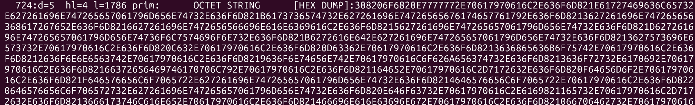


#### Step 5: Verify the signature
We have the (e, n) and the signature. We will compare the output here with that from the body

The message is usually hash hence the sha256sum on the content from the body.


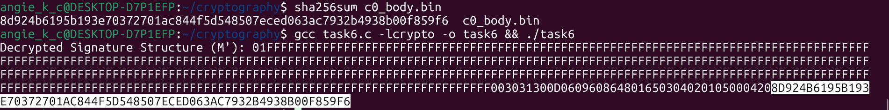